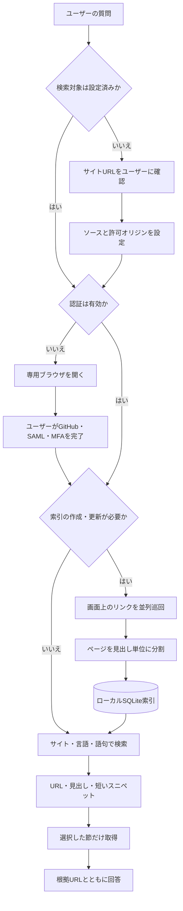

# GitHub Pages Retrieval MCP

認証が必要なPrivate GitHub Pagesを、AIエージェントから検索するためのローカルMCPサーバーです。GitHub、SAML、MFAの認証は専用ブラウザでユーザー自身が完了し、取得したページはローカルのSQLite索引から検索します。

> このMCPはローカル実行専用です。Cloud Agentやクラウド上のコードレビューから、ユーザーPCの認証済みブラウザや索引を利用することはできません。

## 特徴

- 初回にサイトURLを受け取り、検索対象（ソース）を自動設定します。
- サイト内リンクをたどって索引を作成し、サイト構成の変更に追従して更新します。
- 複数サイト・複数言語を、サイト単位または横断で検索し、必要な節だけを取得します。
- Cookie、ページ本文、検索索引はユーザーPC内に保持します。
- 検索結果はURL・見出し・短いスニペットを先に返し、ページ全文を毎回モデルへ渡さないため、トークン消費を抑えられます。

## 動作要件

- Node.js 22.5以降
- 対応クライアント: Claude Code、GitHub Copilot CLI（いずれもプラグインとして導入）

初回起動時に、必要なNode.jsパッケージとPlaywright Chromiumを自動で導入します。

## インストール

### Claude Code

```sh
/plugin marketplace add ma-nakaya/github-pages-retrieval-mcp
/plugin install github-pages-retrieval@github-pages-retrieval-marketplace
```

### GitHub Copilot CLI

```sh
copilot plugin marketplace add ma-nakaya/github-pages-retrieval-mcp
copilot plugin install github-pages-retrieval@github-pages-retrieval-marketplace
```

GitHub Pages検索用のAgent Skill（`skills/github-pages-retrieval/`）を同梱しており、Claude CodeとGitHub Copilot CLIの両方から利用できます。

## 使い方

1. エージェントにPrivate Pagesの内容を調べるよう依頼します。
2. 検索対象が未設定なら、エージェントがサイトURLを質問します。URLを回答すると、ソースID、許可オリジン、専用ブラウザプロファイルが自動設定されます。
3. 認証が必要な場合はローカルブラウザが開きます。GitHub、SAML、MFAを完了し、エージェントに完了したことを伝えます。
4. 初回またはサイト更新時に索引を作成します。その後はコンポーネント名、API名、設定項目などを通常の言葉で検索できます。

依頼の例:

```text
このPrivate Pagesを検索対象にして:
https://example.github.io/private-docs/

日本語版のテーブルコンポーネントで、行選択の設定を調べて
```

## ツール一覧

| Tool | 用途 |
|---|---|
| `list_pages_sources` | 設定済みの検索対象ソースを確認 |
| `configure_pages_source` | サイトURLからソース、許可オリジン、専用ブラウザプロファイルを自動設定（既存設定は上書きしない） |
| `get_source_auth_status` | ソースの認証状態を取得 |
| `begin_source_reauth` | 可視ブラウザを開き、再認証を開始 |
| `validate_source_auth` | 完了した認証セッションを検証し、状態を保存 |
| `fetch_pages_content` | 許可済みURLのページを専用ブラウザ経由で直接取得 |
| `refresh_pages_index` | 索引の作成・更新をバックグラウンドで開始 |
| `get_pages_index` | 索引の状態とページ一覧をページング取得（既定50件） |
| `search_pages_index` | ローカル索引をサイト単位または横断で検索 |
| `fetch_indexed_section` | 索引済みページまたは見出し単位の節を取得 |

通常の質問ではページ一覧に頼らず、`search_pages_index` で索引全体を直接検索し、`fetch_indexed_section` で必要な節だけを取得します。完全なページ一覧が必要な場合だけ、`get_pages_index` の次ページをたどります。

## 検索の仕組み



- サイトマップには依存せず、画面上のナビゲーションリンクからページ構成を検出します。
- 索引はローカルのSQLiteに保存し、検索には多言語向けのFTS5 trigram検索を使います。埋め込みサービスは呼びません。
- 完全な更新が成功すると、サイトからリンクされなくなったページは索引から削除されます。途中で打ち切られた、または一部失敗した更新では、既存の索引を保持します。
- 複数サイトを登録できます。通常は対象サイトだけを検索し、横断検索を依頼した場合（`sourceId` に `all` を指定）だけ全サイトからまとめて検索します。認証と索引更新はサイトごとに行います。

## 設定

手動設定の例は `config.example.json` にあります。主な項目は次のとおりです。

| 項目 | 内容 |
|---|---|
| `stateDir` | 設定・ブラウザプロファイル・索引の保存先ディレクトリ |
| `sources[].id` | ソースの識別子 |
| `sources[].startUrl` | 検索対象サイトのURL |
| `sources[].authProbeUrl` | 認証状態の確認先URL |
| `sources[].allowedOrigins` | アクセスを許可するオリジン |
| `sources[].profileDir` | サイトごとの専用ブラウザプロファイルの保存先 |

プラグインとして導入した場合、保存先はホストが提供する永続ディレクトリを使います。関連する環境変数は次のとおりです。

| 環境変数 | 内容 |
|---|---|
| `GPR_PLUGIN_DATA` | 保存先ディレクトリの上書き（手動起動時に使用） |
| `CLAUDE_PLUGIN_DATA` | Claude Codeが提供する永続ディレクトリ |
| `COPILOT_PLUGIN_DATA` | GitHub Copilot CLIが提供する永続ディレクトリ |
| `PLUGIN_DATA` | 上記が無い場合の汎用の永続ディレクトリ（ランチャーが参照） |
| `GPR_CONFIG_PATH` | 設定ファイルのパス。プラグイン用ランチャーは保存先ディレクトリ配下の `config.local.json` を指定し、直接起動時は `config.local.json` が既定 |

プラグイン更新後も認証状態を維持するには、プラグイン外の永続ディレクトリを指定してください。

手動で起動する場合は次のとおりです。

```sh
npm install
npm test
npm start
```

## ローカルデータとセキュリティ

設定、ブラウザプロファイル、認証状態、検索索引は、非公開のローカルディレクトリへ保存されます。

- アクセスするのは、設定されたPagesオリジン内のHTMLページだけです。
- ソースリポジトリ、GitHub API、外部の埋め込みサービスは利用しません。
- パスワード、MFAコード、CookieをMCPツールへ入力しません。
- 日常利用のChromeプロファイルは使わず、サイトごとの専用プロファイルを作成します。
- 取得したページ本文は信頼できない入力として扱い、根拠URLとともに回答に使います。
- `config.local.json`、ブラウザプロファイル、検索索引をGitへコミットしないでください。

## 開発

| コマンド | 内容 |
|---|---|
| `npm test` | 型チェック、単体テスト、プラグイン検証をまとめて実行 |
| `npm run build` | 型チェックのみ（`tsc --noEmit`） |
| `npm run test:unit` | 単体テスト（`test/page-index.test.ts`） |
| `npm run validate:plugin` | プラグインマニフェストとMCP設定の検証 |
| `npm start` | MCPサーバーを起動（`tsx src/index.ts`） |
| `npm run start:plugin` | プラグイン用ランチャーで起動（依存関係とChromiumを必要に応じて自動導入） |

## ライセンス

MIT License（`LICENSE` を参照）
